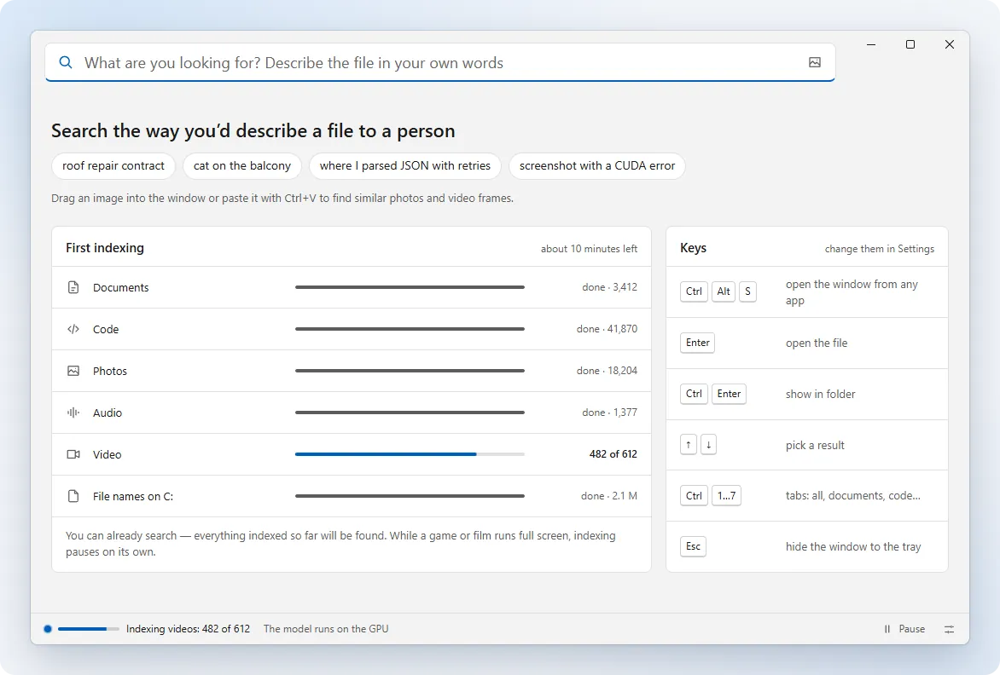
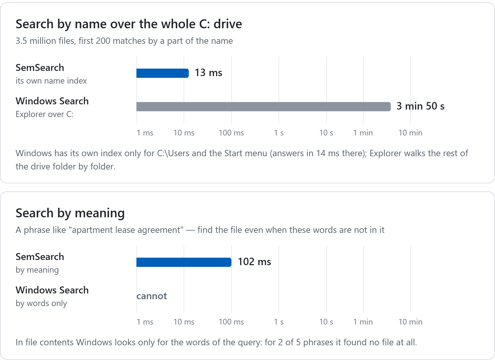
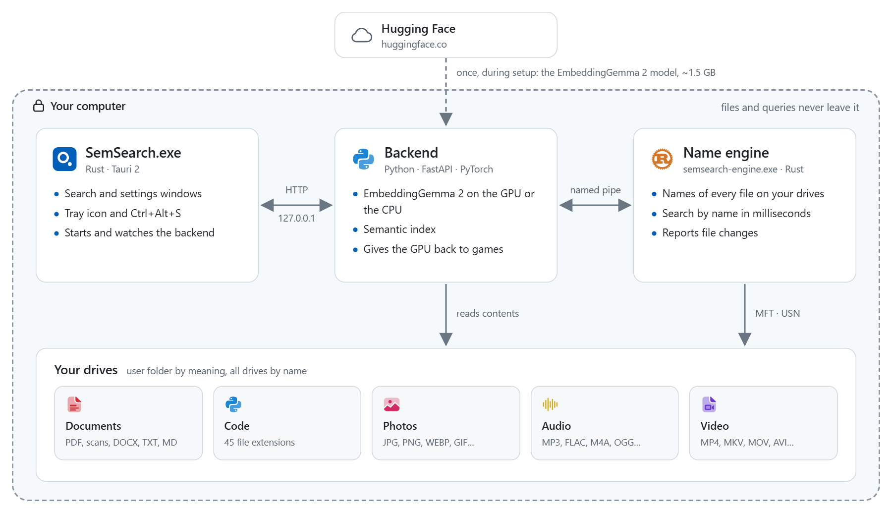
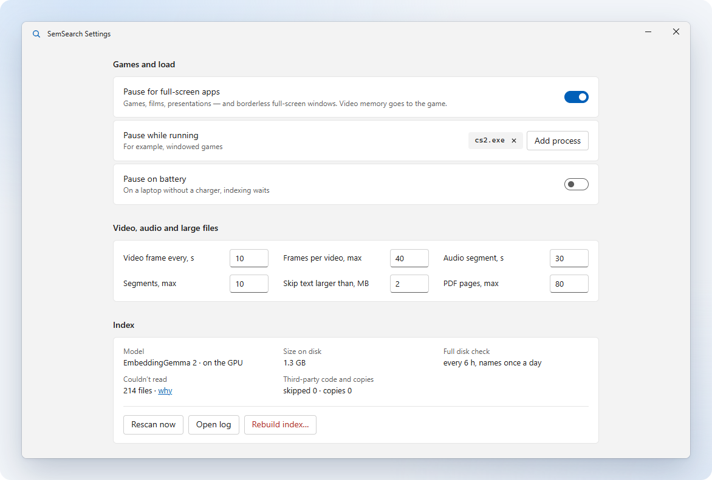

<p align="center">
  <picture>
    <source media="(prefers-color-scheme: dark)" srcset="brand/logo/svg/horizontal-white.svg">
    
  </picture>
</p>

<h3 align="center">Search your files in your own words</h3>

<p align="center">
  Type what you are looking for, and SemSearch finds the document, photo, video frame or piece of code,
  even when those words are not in the file name. Everything runs on your computer.
</p>

<p align="center">
  
  
  
  
  <a href="LICENSE"></a>
  
</p>

<p align="center">
  <a href="#features">Features</a> ·
  <a href="#installation">Installation</a> ·
  <a href="#usage">Usage</a> ·
  <a href="#how-it-works">How it works</a> ·
  <a href="#troubleshooting">Troubleshooting</a> ·
  <a href="#development">Development</a> ·
  <a href="#code-signing-policy">Code signing policy</a>
</p>

<p align="center"><a href="README.md">Русский</a> · <b>English</b></p>

<picture>
  <source media="(prefers-color-scheme: dark)" srcset="docs/images/clip-en-dark.webp">
  
</picture>

## Features

- Searching for "roof repair contract" finds "Roof repair contract No. 14.pdf" and opens it at the page that matched.
- Photos and videos are found from a description or from a similar picture. For a video you see the second where the match is.
- In code you can find a function by what it does. Third-party libraries and build output stay out of the results.
- File names are searched across all drives in milliseconds, like in Everything.
- SemSearch stays out of the way of games: it gives them the GPU and pauses while a game runs full screen.
- The internet is only needed during setup. Your files and queries are not sent anywhere.

<picture>
  <source media="(prefers-color-scheme: dark)" srcset="docs/images/speed-en-dark.png">
  
</picture>

<details>
<summary><b>How it was measured</b></summary>
<br>

The numbers come from [`tools/bench_search.py`](tools/bench_search.py). It takes 5 queries by a part of the name and
5 phrases, runs each one 10 times after a warm-up, and the table shows the median. The time runs from sending the query
until every result is in. Windows Search was queried through the same index Explorer uses. The chart uses a log scale.

| | SemSearch | Windows Search |
|---|---|---|
| By name over the whole C: drive, first 200 files | 13 ms with its own name index of the whole drive (3.5 million files). Counting the search by meaning that the window also runs for every query, it is 148 ms | 3 min 50 s: outside its index, Explorer walks the drive (measured with `dir /s`). By default Windows only indexes `C:\Users` and the Start menu, where it answers in 14 ms |
| By meaning, a phrase | 102 ms, with 21 to 54 files found per phrase | Not supported. Its search by words (FREETEXT) answers in 4.8 ms but found no file at all for 2 of the 5 phrases |

Computer: Intel Core i5-13600KF, NVIDIA GeForce RTX 4070 SUPER, SSD, measured on October 16, 2026. To repeat it, start
SemSearch, wait until it finishes indexing and run `.venv\Scripts\python.exe tools\bench_search.py --walk`. Then
`.venv\Scripts\python.exe tools\make_readme_images.py speed` redraws the chart.

</details>

## Installation

1. Download `SemSearch-Setup-<version>.exe` from [Releases](../../releases) and run it. SemSearch installs for the
   current user (into `%LOCALAPPDATA%\Programs\SemSearch` by default), so you don't need administrator rights.
2. Windows asks for permission only for Visual C++ (if it is missing) and for fast search by name, which is a Task
   Scheduler task that reads the MFT. You can say no to it, and names will then be found by an ordinary walk, slower.
3. Setup downloads the model (about 1.5 GB) and PyTorch, with CUDA if there is an NVIDIA GPU and the CPU build otherwise.
   That is why it needs the internet. If the connection drops, press Retry.

The installer is not signed yet, so SmartScreen may warn about it. If it does, click More info and then Run anyway.
How releases are going to be signed is described in [Code signing policy](#code-signing-policy).
To update, run the new installer over the old version; your settings, index and model stay where they are. You can
remove SemSearch in Apps or Add or remove programs, and choose to wipe the settings, the index and the model as well.

| Requirements | |
|---|---|
| OS | Windows 11 or Windows 10 (version 1709 and later), 64-bit. macOS and Linux are not supported |
| GPU | NVIDIA RTX 20xx or newer, optional. Without one (or with an older card) the model runs on the CPU, slower |
| WebView2 Runtime | Built into Windows 11 and usually installed with Edge on Windows 10. If it is missing, the installer offers to add it |
| Disk space | About 7 GB with an NVIDIA GPU and about 3.5 GB without, for the Python environment, the model (1.5 GB) and the index |

<details>
<summary><b>Building from source</b></summary>
<br>

You need Python 3.11 or later, [Rust](https://rustup.rs) and Visual Studio Build Tools with the "Desktop development
with C++" workload.

1. Set up the Python environment. With an NVIDIA driver it gets PyTorch with CUDA, otherwise the CPU build:
   ```bat
   setup.bat
   ```
2. Build `SemSearch.exe` and the name engine `bin\semsearch-engine.exe`:
   ```bat
   build.cmd
   ```
3. Run `SemSearch.exe`. On the first start it downloads the model (about 1.5 GB), and the launch screen shows how much
   is left. Search by name works right away.

You can also skip `build.cmd`: after `setup.bat`, run `start.bat`. The search then opens in the browser, the hotkey opens
it there too, there is no tray icon, and names are found by a built-in walk, which is slower. `build-installer.cmd`
builds your own installer (see Development).

</details>

<details>
<summary><b>Fast name search through the MFT (administrator rights)</b></summary>
<br>

The engine can read the MFT and the USN journal only with administrator rights. The "SemSearch Engine" Task Scheduler
task gives it those at sign-in without a UAC prompt. The installer sets it up if you agree. If you build from source, run:

```bat
engine\install-task.cmd
```

The script asks for UAC (you need an administrator account) and copies the engine to `%ProgramFiles%\SemSearch\`.
Nothing can be written there without administrator rights, so the engine can't be swapped out. Its log is
`%ProgramFiles%\SemSearch\logs\engine.log`, and from the data folder it reads only the list of drives (`config.json`).
Run the script again after every rebuild to update the copy. `engine\uninstall-task.cmd` removes the task and the copy.

Without the task, the backend starts `bin\semsearch-engine.exe` itself, without rights. The engine then walks the drive
and watches for changes with `ReadDirectoryChangesW`. The name index takes longer to build that way, and everything else
works the same. Drives that are not NTFS (exFAT, FAT32, ReFS) are always indexed by walking.

</details>

## Usage

Press <kbd>Ctrl</kbd>+<kbd>Alt</kbd>+<kbd>S</kbd> and type what you are looking for, for example "roof repair contract",
"screenshot with a CUDA error" or "where I parsed JSON with retries".

| Keys | What they do |
|---|---|
| <kbd>Ctrl</kbd>+<kbd>Alt</kbd>+<kbd>S</kbd> | Show or hide the window from any app. If AltGr+S types a letter in one of your layouts (Polish, Czech, Hungarian and others), the first start picks <kbd>Ctrl</kbd>+<kbd>Alt</kbd>+<kbd>Space</kbd> instead. You can change it in Settings |
| <kbd>Esc</kbd> | Hide the window |
| <kbd>↑</kbd> <kbd>↓</kbd> | Pick a result |
| <kbd>Enter</kbd> | Open the file |
| <kbd>Ctrl</kbd>+<kbd>Enter</kbd> | Show it in its folder |
| <kbd>Ctrl</kbd>+<kbd>1</kbd> … <kbd>7</kbd> | Tabs: all, documents, code, photos, video, audio, by name |
| <kbd>Ctrl</kbd>+<kbd>F</kbd> | Find similar photos and frames |
| <kbd>Ctrl</kbd>+<kbd>Shift</kbd>+<kbd>C</kbd> | Copy the path |
| <kbd>Ctrl</kbd>+<kbd>V</kbd> | Search by the picture on the clipboard (or drop one on the window) |

Language (English, Russian or "Same as Windows"), theme, autostart, folders, drives, exclusions and pauses are set in
Settings. You open them with the button at the bottom of the window or from the tray menu.

## How it works

<picture>
  <source media="(prefers-color-scheme: dark)" srcset="docs/images/architecture-en-dark.png">
  
</picture>

| Part | What it does |
|---|---|
| `SemSearch.exe` (Rust, Tauri 2; source in `shell/`) | Frameless windows, the tray icon, the hotkey and autostart. It starts the backend and restarts it if it crashes |
| `server.py` → `app.py` (Python) | The EmbeddingGemma 2 model (on the GPU when the card is supported), the content index and the API for the interface |
| `ui/` | The interface, built 1:1 from the "SemSearch Desktop" mockup (its source is in `design/`). File-type icons are in `ui/filetypes/` |
| Name engine (Rust; source in `engine/`) | Keeps the names of every file on the drives by reading the MFT and the USN journal or by walking folders. It searches by name in milliseconds and reports file changes |
| Installer (Rust, Tauri 2; source in `installer/`) | Installs Python, PyTorch, the model, the engine task and shortcuts for the current user, and later updates and removes the program. Details are in [`docs/INSTALLER.md`](docs/INSTALLER.md) (in Russian) |

How the parts talk to each other is described in [`docs/API.md`](docs/API.md) (in Russian).

<details>
<summary><b>What gets indexed, and in what order</b></summary>
<br>

- Search by meaning covers the user folder and the known folders outside it, such as Documents moved to another drive.
  AppData, dot folders and `node_modules` are skipped. OneDrive files that are on the disk get indexed, while cloud-only
  ones are not downloaded, although they still turn up in search by name. Documents go first, then code, photos, audio
  and video.
- Search by name covers all fixed drives. You can change the list in Settings.
- SemSearch recognises builds and dependencies by the project files next to them rather than by the folder name: `bin`/`obj`
  next to a `.csproj`, `Library` in a Unity project, `Saved`/`Intermediate` next to a `.uproject`, a folder with
  `pyvenv.cfg` and so on. A plain "Library" folder full of books is therefore still searched.
- Third-party code is skipped by default (the "Third-party code and libraries" setting changes that). This means git
  submodules, downloaded source archives (`*-main`, `*-master`, `*-1.2.3`), anything the project's `.gitignore` treats as
  not source, and generated files. Clones of other people's repositories without your commits and files with a library
  header go last. The rule applies only to code and `.md`/`.rst`.
- A PDF page with almost no text goes to the model as a picture, so a scanned contract is found too.
- SemSearch learns about changes from the change journal within seconds. It picks a file up once nothing has written to
  it for 3 seconds. Every 6 hours a full pass runs just in case.
- HDDs, USB sticks and network drives are read with fewer threads. You can safely remove an external drive: SemSearch
  lets go of it by itself, picks it up again when it is back, and keeps the index of its contents in the meantime.

| Type | Extensions |
|---|---|
| Documents | PDF, DOCX, TXT, MD, RST, ORG, TEX |
| Code | 45 extensions: Python, JS/TS, C#, C/C++, Java, Kotlin, Go, Rust, PHP, Lua, SQL, shaders, YAML, TOML… |
| Photos | JPG, PNG, WEBP, BMP, GIF, TIFF |
| Audio | MP3, WAV, FLAC, OGG, M4A, OPUS, AAC, WMA |
| Video | MP4, MKV, AVI, MOV, WEBM, WMV, M4V |

</details>

<details>
<summary><b>How SemSearch gives the GPU back</b></summary>
<br>

`throttle.py` manages the load. Work is cut into slices of 1 to 5 ms, and the frames of games and of the desktop get
through between them. While you are at the computer, indexing runs gently. With a heavy game in a window it slows down
a lot, and while you are away it runs at full speed, except on a laptop on battery or in battery saver. Fullscreen games
and movies, and the processes you list in Settings, pause indexing.

<picture>
  <source media="(prefers-color-scheme: dark)" srcset="docs/images/settings-en-dark.png">
  
</picture>

The text part of the model runs as CUDA graphs, one per layer (`cudagraphs.py`). Each slice reaches the GPU as a single
call instead of about 50 small ones, and gets one and a half to two and a half times more work done in the same time.

The slice size depends on the GPU. Slices are smaller on a slow card, and on a card with 2 to 4 GB of memory they are
sized by the free video memory. The model moves to the CPU if torch cannot use your card (the CUDA 12.8 build supports
RTX 20xx and newer, but not GTX 10xx), if the driver is too old, or if even the model itself does not fit in video
memory. The reason is written to `semsearch.log`.

</details>

### Where the data lives

`%LOCALAPPDATA%\SemSearch` holds the settings (`config.json`), indexes, previews, logs and the model (`models\`, about
1.5 GB). SemSearch only reads its program folder while it runs, so you can put that folder anywhere, `Program Files`
included.

- To keep the data somewhere else, set the `SEMSEARCH_DATA_DIR` environment variable to an absolute path. Make it a
  permanent user variable so the engine started by the Task Scheduler task sees it too.
- If an old version left `data\` and `config.json` next to the program, they move here on the first start.
- A model that older versions downloaded into the shared Hugging Face cache (`%USERPROFILE%\.cache\huggingface\hub`)
  also moves here on the first start, so you don't have to download it again. SemSearch leaves a cache of your own
  (`HF_HUB_CACHE`) alone.

## Troubleshooting

The logs are in `%LOCALAPPDATA%\SemSearch`. The backend writes `semsearch.log`, the window and tray write `shell.log`,
and the engine writes `engine.log` when it runs without the task. The engine started by the task writes to
`%ProgramFiles%\SemSearch\logs\engine.log`.

<details>
<summary><b>A file is not found</b></summary>
<br>

Check that its folder is under "Search by meaning" and is not excluded (Settings → Where to search). The Index section
there lists the files that could not be read and has a "Rebuild index…" button.

</details>

<details>
<summary><b>The hotkey types a letter or does not open the window</b></summary>
<br>

<kbd>Ctrl</kbd>+<kbd>Alt</kbd>+letter works as <kbd>AltGr</kbd>+letter, which types letters in Polish, Czech, Hungarian
and other layouts. SemSearch looks at the layouts installed at its first start. If you added a layout later and the
hotkey gets in the way, change it in Settings. If another program has taken the shortcut, Settings will tell you.

</details>

<details>
<summary><b>SemSearch does not start</b></summary>
<br>

- If the WebView2 Runtime is missing, SemSearch says so at start and opens the download page.
- If the search server fails with code 0xC0000135, the Microsoft Visual C++ Redistributable (x64) that PyTorch needs is
  missing. The installer adds it by itself.

</details>

<details>
<summary><b>Port 8765 is taken by another program</b></summary>
<br>

AnkiConnect, for example, uses it. SemSearch finds a free port nearby on its own, and you can set your own port in
`config.json` (`"port"`).

</details>

<details>
<summary><b>Indexing runs on the CPU although there is a GPU</b></summary>
<br>

The reason is in `semsearch.log`. Most often the card is older than RTX 20xx (the CUDA 12.8 build of torch does not
support it), the NVIDIA driver is too old (the log then suggests updating it), or there is not enough video memory.

</details>

## Development

- `setup.bat` sets up the Python environment. Versions are pinned in `requirements-torch.txt` (torch, torchvision) and
  `requirements.txt`.
- `build.cmd` makes release builds of the engine (`engine\`) and the shell (`shell\`) and puts `bin\semsearch-engine.exe`
  and `SemSearch.exe` in the root. It needs Rust (the minimum version is `rust-version` in `Cargo.toml`) and Visual Studio
  Build Tools (MSVC and the Windows SDK). The engine and the shell are linked with the static CRT, so neither the engine
  nor `SemSearch.exe` needs the VC++ Redistributable.
- `installer\` and `build-installer.cmd` build the installer `dist\SemSearch-Setup-<version>.exe`. What it does and which
  files it ships (`installer\payload.txt`) is described in [`docs/INSTALLER.md`](docs/INSTALLER.md). The installer step
  that downloads the model is `tools\fetch_model.py`; to run it by hand: `.venv\Scripts\python.exe tools\fetch_model.py`.
- Signing the installer, `SemSearch.exe` and the engine is optional, and the build works without it. The certificate is
  set with `SEMSEARCH_SIGN`, which holds signtool arguments: a file (`/f C:\keys\semsearch.pfx /p <password>`), the Windows
  store or a token (`/sha1 <thumbprint>`), or Azure Trusted Signing (`/dlib <…\Azure.CodeSigning.Dlib.dll> /dmdf <…\metadata.json>`).
  There are also `SEMSEARCH_SIGNTOOL` (path to signtool.exe, taken from Windows Kits 10 by default), `SEMSEARCH_SIGN_TS`
  (timestamp server, DigiCert by default) and `SEMSEARCH_SIGN_TEST=1` (a self-signed certificate for testing the build).
- `mock_api.py` serves the mockup's data for interface work (port 8799). Launch-screen scenarios: `/dev/scenario/boot`,
  `firstrun`, `cpu`, `booterror`, `bootnet`, `hold-download`, `hold-model`. The language is switched with
  `/dev/lang/<system|ru|en>`, and in English the demo files are English too.
- `tools\make_readme_images.py` draws the pictures of both READMEs (`docs\images\`): the clip and screenshots of the
  interface on the `mock_api.py` data, the speed chart and the diagram, in English and Russian. It needs Edge or Chrome.
  Run it again when the interface changes.
- `tools\bench_search.py` measures search speed against Windows Search for the chart above.
- `tools\make_filetype_icons.py` makes the file-type icons (`ui\filetypes\`). You only need to run it when the icons
  themselves or the list of extensions change.
- `tools\frameprobe` (Rust) and `tools\gpu_bench.py` check how smoothly frames come through while indexing runs.
- The environment variables (`SEMSEARCH_DATA_DIR`, `SEMSEARCH_PORT`, `SEMSEARCH_ROOT`, `SEMSEARCH_DEV_URL`,
  `SEMSEARCH_NO_BACKEND`) and how the parts talk to each other are described in [`docs/API.md`](docs/API.md).
- The logo, icons and colours are in [`brand/`](brand/README.md).

## Code signing policy

Free code signing provided by [SignPath.io](https://about.signpath.io), certificate by
[SignPath Foundation](https://signpath.org).

The signature is free: SignPath.io provides it and the certificate is issued to SignPath Foundation, so the file
properties show SignPath Foundation as the publisher. What gets signed is the installer `SemSearch-Setup-<version>.exe`
and the program files inside it: `SemSearch.exe`, the name engine `bin\semsearch-engine.exe` and `uninstall.exe`.
GitHub Actions builds them from this repository's source ([`.github/workflows/release.yml`](.github/workflows/release.yml))
when a new version is released, and a person from the list below approves every signature by hand. Files made by others
are not signed: the Python inside the installer, PyTorch, the Python packages and the model come with their authors'
signatures or without any. Until SignPath approves the project, releases come out unsigned.

| Role | What they do | Who |
|---|---|---|
| Committers | Change the code without a separate review | [@GITHUB_USER](https://github.com/GITHUB_USER) |
| Reviewers | Review changes from others (pull requests) before they are accepted | [@GITHUB_USER](https://github.com/GITHUB_USER) |
| Approvers | Decide which release gets signed and approve every signing request | [@GITHUB_USER](https://github.com/GITHUB_USER) |

For now all three roles are held by one person, the author of the project.

### Privacy

This program will not transfer any information to other networked systems unless specifically requested by the user or
the person installing or operating it. SemSearch has no telemetry and no crash reports. Files, their contents, the
index and search queries stay on the computer: the backend accepts connections from this computer only (127.0.0.1).

SemSearch goes online only for what it needs to work, and only during setup or on the first start. Once downloaded, the
model is loaded from disk without contacting the network.

| What is downloaded | From | When | Privacy policy |
|---|---|---|---|
| PyTorch (torch, torchvision) | download.pytorch.org | During setup | [The Linux Foundation](https://www.linuxfoundation.org/legal/privacy-policy) (PyTorch Foundation) |
| Python packages | pypi.org, files.pythonhosted.org | During setup | [PyPI](https://policies.python.org/pypi.org/Privacy-Notice/) |
| The EmbeddingGemma 2 model (about 1.5 GB) | huggingface.co | During setup. If you built the program yourself or the model is gone from the disk, on start | [Hugging Face](https://huggingface.co/privacy) |
| Visual C++ Redistributable and WebView2 Runtime | Microsoft (aka.ms, go.microsoft.com) | During setup, only if they are missing. WebView2 is installed only if you agree | [Microsoft](https://www.microsoft.com/privacy/privacystatement) |

These sites see what any download shows them: the IP address and the usual request headers with program versions.

## License

SemSearch is licensed under [Apache-2.0](LICENSE). You may use, change and redistribute the code, in commercial products
too, as long as you include the license text, keep the attribution notices and mark your changes. The license grants no
rights to the SemSearch name or logo.

- The file-type icons in `ui/filetypes/` are based on the `@pierre/trees` set, which is also Apache-2.0 (see
  [`ui/filetypes/LICENSE`](ui/filetypes/LICENSE)).
- The EmbeddingGemma 2 model is not in the repository. It is downloaded from Hugging Face during setup (or on the first
  start if you built the program yourself) and comes under Google's terms, which are on the model page.
