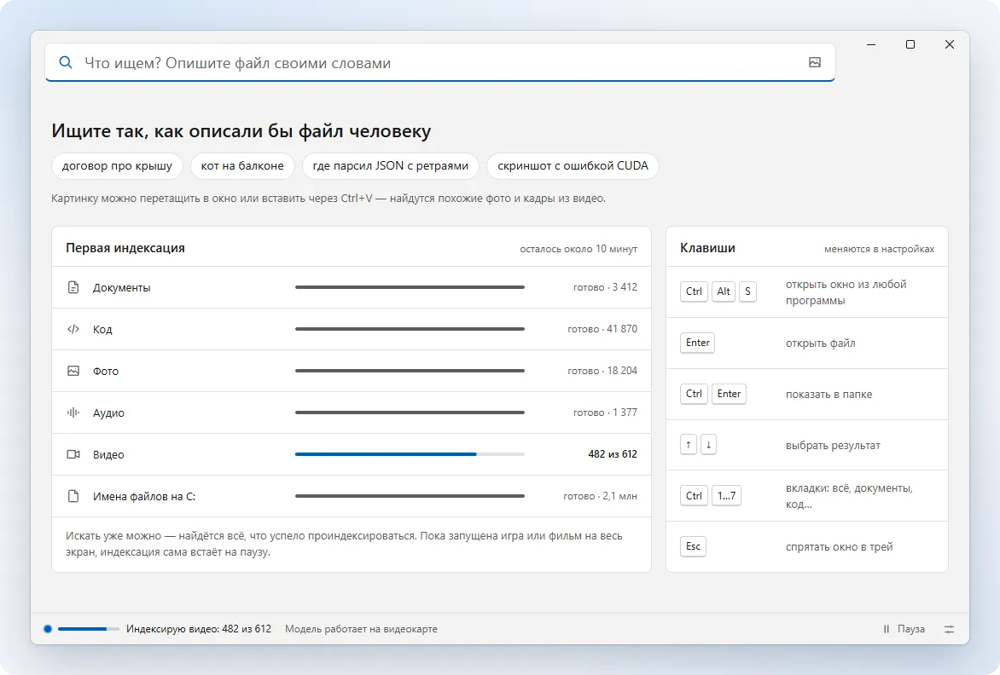
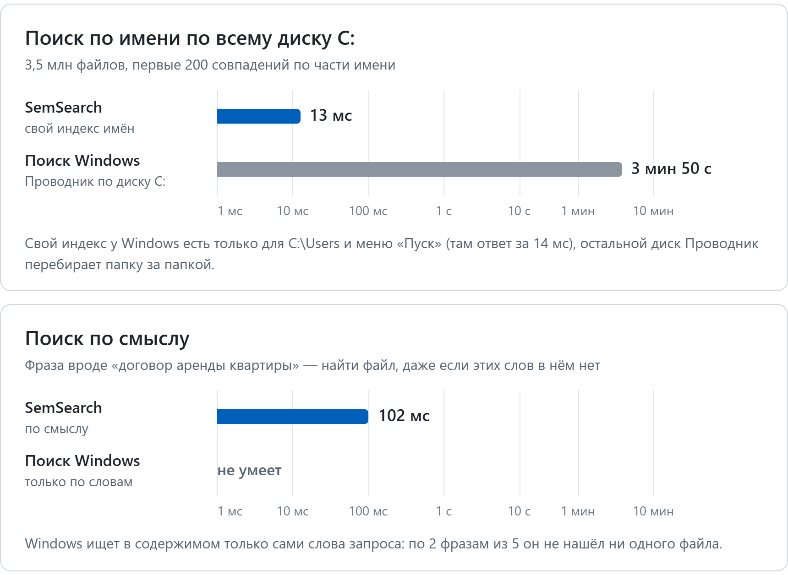
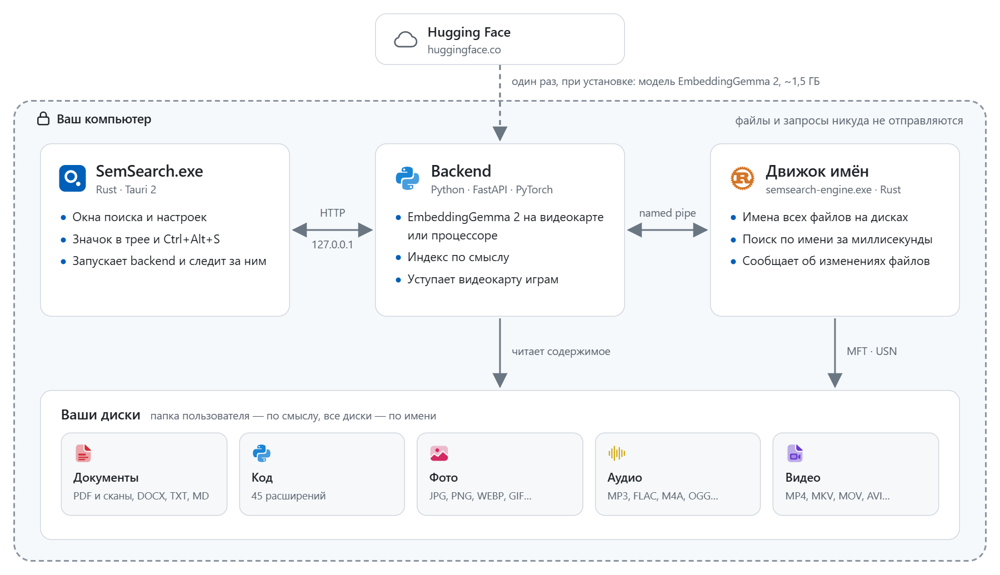
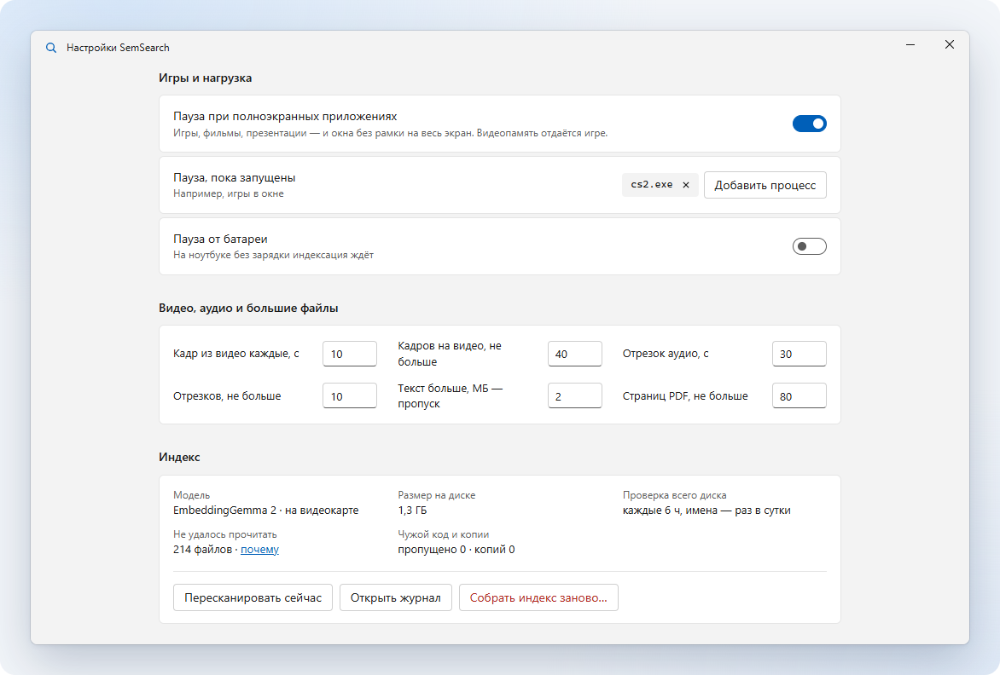

<p align="center">
  <picture>
    <source media="(prefers-color-scheme: dark)" srcset="brand/logo/svg/horizontal-white.svg">
    
  </picture>
</p>

<h3 align="center">Поиск файлов своими словами</h3>

<p align="center">
  Пишете, что ищете, и SemSearch находит документ, фото, кадр из видео или кусок кода,
  даже если этих слов нет в названии. Всё считается на вашем компьютере.
</p>

<p align="center">
  
  
  
  
  <a href="LICENSE"></a>
  
</p>

<p align="center">
  <a href="#возможности">Возможности</a> ·
  <a href="#установка">Установка</a> ·
  <a href="#как-пользоваться">Как пользоваться</a> ·
  <a href="#как-устроено">Как устроено</a> ·
  <a href="#если-что-то-не-так">Если что-то не так</a> ·
  <a href="#разработка">Разработка</a> ·
  <a href="#политика-подписи-кода-code-signing-policy">Политика подписи кода</a>
</p>

<p align="center"><b>Русский</b> · <a href="README.en.md">English</a></p>

<picture>
  <source media="(prefers-color-scheme: dark)" srcset="docs/images/clip-ru-dark.webp">
  
</picture>

## Возможности

- По запросу «договор про крышу» найдётся «Договор подряда №14 — кровля.pdf», и SemSearch сразу откроет нужную страницу.
- Фото и видео ищутся по описанию или по похожей картинке. В видео видно, на какой секунде нашлось совпадение.
- В коде можно найти функцию по тому, что она делает. Чужие библиотеки и сборки в выдачу не попадают.
- Имена файлов ищутся по всем дискам за миллисекунды, как в Everything.
- Играм SemSearch не мешает: уступает им видеокарту, а пока игра открыта на весь экран, стоит на паузе.
- Интернет нужен только при установке. Файлы и запросы никуда не отправляются.

<picture>
  <source media="(prefers-color-scheme: dark)" srcset="docs/images/speed-ru-dark.png">
  
</picture>

<details>
<summary><b>Как мерили</b></summary>
<br>

Замер делает скрипт [`tools/bench_search.py`](tools/bench_search.py). Он берёт 5 запросов по части имени и 5 фраз,
гоняет каждый 10 раз после прогрева, и в таблицу идёт медиана. Время считается от отправки запроса до получения всех
результатов. Поиск Windows спрашивается через тот же индекс, которым пользуется Проводник. Шкала на графике
логарифмическая.

| | SemSearch | Поиск Windows |
|---|---|---|
| По имени по всему диску C:, первые 200 файлов | 13 мс, свой индекс имён всего диска (3,5 млн файлов). Если добавить поиск по смыслу, который окно запускает на каждый запрос, выходит 148 мс | 3 мин 50 с: вне своего индекса Проводник перебирает диск, замер сделан через `dir /s`. Индекс у Windows по умолчанию есть только для `C:\Users` и меню «Пуск», там ответ приходит за 14 мс |
| По смыслу, фраза | 102 мс, на каждую фразу нашлось от 21 до 54 файлов | Так не умеет. Поиск по словам (FREETEXT) отвечает за 4,8 мс, но по 2 фразам из 5 не нашёл ни одного файла |

Компьютер: Intel Core i5-13600KF, NVIDIA GeForce RTX 4070 SUPER, SSD, замер от 16 октября 2026. Чтобы повторить у себя,
запустите SemSearch, дождитесь конца индексации и выполните `.venv\Scripts\python.exe tools\bench_search.py --walk`.
График потом перерисует `.venv\Scripts\python.exe tools\make_readme_images.py speed`.

</details>

## Установка

1. Скачайте `SemSearch-Setup-<версия>.exe` со страницы [Releases](../../releases) и запустите. Программа ставится для
   текущего пользователя (по умолчанию в `%LOCALAPPDATA%\Programs\SemSearch`), права администратора не нужны.
2. Windows спросит разрешение только на Visual C++ (если его нет) и на быстрый поиск по имени. Это задача Планировщика,
   которая читает MFT. От неё можно отказаться, тогда имена будут искаться обычным обходом, медленнее.
3. Во время установки скачиваются модель (около 1,5 ГБ) и PyTorch: с CUDA, если есть видеокарта NVIDIA, иначе версия
   для процессора. Поэтому нужен интернет. Если сеть оборвалась, нажмите «Повторить».

Установщик пока не подписан, и SmartScreen может о нём предупредить. Тогда нажмите «Подробнее», потом «Выполнить
в любом случае». Как выпуски будут подписываться, описано в разделе
[Политика подписи кода](#политика-подписи-кода-code-signing-policy). Новую версию ставьте тем же установщиком поверх
старой: настройки, индекс и модель останутся на месте. Удалить SemSearch можно через «Приложения» или «Установка
и удаление программ», заодно можно стереть настройки, индекс и модель.

| Что нужно | |
|---|---|
| Система | Windows 11 или Windows 10 (версия 1709 и новее), 64-бит. macOS и Linux не поддерживаются |
| Видеокарта | NVIDIA RTX 20xx или новее, по желанию. Без неё (или со старой картой) модель считает на процессоре, медленнее |
| WebView2 Runtime | В Windows 11 уже есть, в Windows 10 обычно приходит вместе с Edge. Если его нет, установщик предложит его поставить |
| Место на диске | Около 7 ГБ с видеокартой NVIDIA и около 3,5 ГБ без неё. Сюда входят окружение Python, модель (1,5 ГБ) и индекс |

<details>
<summary><b>Сборка из исходников</b></summary>
<br>

Понадобятся Python 3.11 или новее, [Rust](https://rustup.rs) и Visual Studio Build Tools с компонентом «Разработка
классических приложений на C++».

1. Соберите окружение Python. Если есть драйвер NVIDIA, поставится PyTorch с CUDA, иначе сборка для процессора:
   ```bat
   setup.bat
   ```
2. Соберите `SemSearch.exe` и движок имён `bin\semsearch-engine.exe`:
   ```bat
   build.cmd
   ```
3. Запустите `SemSearch.exe`. При первом запуске он скачает модель (около 1,5 ГБ), на экране запуска видно, сколько
   осталось. Искать по имени можно сразу.

Можно обойтись и без `build.cmd`: после `setup.bat` запустите `start.bat`. Поиск тогда откроется в браузере, горячая
клавиша будет открывать его там же, значка в трее не будет, а имена будут искаться встроенным обходом, медленнее.
Свой установщик собирается через `build-installer.cmd` (см. «Разработка»).

</details>

<details>
<summary><b>Быстрый поиск по имени через MFT (права администратора)</b></summary>
<br>

Читать MFT и журнал USN движок может только с правами администратора. Для этого есть задача Планировщика
«SemSearch Engine»: она запускается при входе в Windows и не спрашивает UAC. Установщик ставит её сам, если вы
согласились. Если вы собираете программу из исходников, запустите:

```bat
engine\install-task.cmd
```

Скрипт спросит UAC (нужна учётная запись администратора) и скопирует движок в `%ProgramFiles%\SemSearch\`. Без прав
администратора туда ничего не записать, так что подменить движок не получится. Журнал движка лежит
в `%ProgramFiles%\SemSearch\logs\engine.log`, а из папки данных он читает только список дисков (`config.json`). После
каждой пересборки запускайте скрипт заново, чтобы обновить копию. Убрать задачу и копию можно через `engine\uninstall-task.cmd`.

Если задачи нет, backend сам запускает `bin\semsearch-engine.exe` без прав. Тогда движок обходит диск и следит
за изменениями через `ReadDirectoryChangesW`. Индекс имён в этом случае строится дольше, остальное работает так же.
Диски не NTFS (exFAT, FAT32, ReFS) всегда индексируются обходом.

</details>

## Как пользоваться

Нажмите <kbd>Ctrl</kbd>+<kbd>Alt</kbd>+<kbd>S</kbd> и напишите, что ищете. Документы ищутся запросами вроде «договор
про крышу» или «смета на кухню», фото и кадры из видео вроде «кот на балконе» или «скриншот с ошибкой CUDA», код вроде
«где парсил JSON с ретраями».

| Клавиши | Что делают |
|---|---|
| <kbd>Ctrl</kbd>+<kbd>Alt</kbd>+<kbd>S</kbd> | Показать или спрятать окно из любой программы. Если в ваших раскладках AltGr+S набирает букву (польская, чешская, венгерская и т. п.), при первом запуске назначится <kbd>Ctrl</kbd>+<kbd>Alt</kbd>+<kbd>Пробел</kbd>. Сочетание можно поменять в «Настройках» |
| <kbd>Esc</kbd> | Спрятать окно |
| <kbd>↑</kbd> <kbd>↓</kbd> | Выбрать результат |
| <kbd>Enter</kbd> | Открыть файл |
| <kbd>Ctrl</kbd>+<kbd>Enter</kbd> | Показать в папке |
| <kbd>Ctrl</kbd>+<kbd>1</kbd> … <kbd>7</kbd> | Вкладки: всё, документы, код, фото, видео, аудио, по имени |
| <kbd>Ctrl</kbd>+<kbd>F</kbd> | Найти похожие фото и кадры |
| <kbd>Ctrl</kbd>+<kbd>Shift</kbd>+<kbd>C</kbd> | Копировать путь |
| <kbd>Ctrl</kbd>+<kbd>V</kbd> | Искать по картинке из буфера обмена (или перетащите её в окно) |

Язык (русский, английский или как в Windows), тема, автозапуск, папки, диски, исключения и паузы настраиваются
в «Настройках». Их открывает кнопка внизу окна или меню в трее.

## Как устроено

<picture>
  <source media="(prefers-color-scheme: dark)" srcset="docs/images/architecture-ru-dark.png">
  
</picture>

| Часть | Что делает |
|---|---|
| `SemSearch.exe` (Rust, Tauri 2; исходники `shell/`) | Окна без рамки, трей, горячая клавиша и автозапуск. Запускает backend и перезапускает его, если тот упал |
| `server.py` → `app.py` (Python) | Модель EmbeddingGemma 2 (на видеокарте, если она подходит), индекс содержимого и API для интерфейса |
| `ui/` | Интерфейс, сделанный 1:1 по макету «SemSearch Desktop» (исходники макета в `design/`). Значки типов файлов лежат в `ui/filetypes/` |
| Движок имён (Rust; исходники `engine/`) | Хранит имена всех файлов на дисках: читает MFT и журнал USN или обходит папки. Ищет по имени за миллисекунды и сообщает об изменениях файлов |
| Установщик (Rust, Tauri 2; исходники `installer/`) | Ставит для текущего пользователя Python, PyTorch, модель, задачу движка и ярлыки, а потом обновляет и удаляет программу. Подробности в [`docs/INSTALLER.md`](docs/INSTALLER.md) |

Как части общаются между собой, описано в [`docs/API.md`](docs/API.md).

<details>
<summary><b>Что и в каком порядке индексируется</b></summary>
<br>

- По смыслу индексируются папка пользователя и известные папки вне неё, например «Документы», перенесённые на другой
  диск. AppData, папки с точкой и `node_modules` пропускаются. Файлы OneDrive, которые лежат на диске, индексируются,
  а файлы «только в облаке» не скачиваются, хотя по имени находятся и они. Сначала идут документы, потом код, фото,
  аудио и видео.
- По имени индексируются все несъёмные диски, список можно поменять в «Настройках».
- Сборки и зависимости SemSearch узнаёт по файлам проекта рядом, а не по имени папки: `bin`/`obj` рядом с `.csproj`,
  `Library` в проекте Unity, `Saved`/`Intermediate` рядом с `.uproject`, папка с `pyvenv.cfg` и т. п. Поэтому обычная
  папка «Library» с книгами в поиск попадает.
- Чужой код по умолчанию не индексируется (это меняется в настройке «Чужой код и библиотеки»). Сюда относятся
  git-подмодули, скачанные архивы исходников (`*-main`, `*-master`, `*-1.2.3`), всё, что `.gitignore` проекта считает
  не исходниками, и сгенерированные файлы. Клоны чужих репозиториев без ваших коммитов и файлы с шапкой библиотеки идут
  в последнюю очередь. Правило касается только кода и `.md`/`.rst`.
- Если на странице PDF почти нет текста, она уходит в модель картинкой, так что отсканированный договор тоже найдётся.
- Об изменениях SemSearch узнаёт из журнала изменений за секунды. Файл берётся в работу, когда в него 3 секунды ничего
  не пишут. Раз в 6 часов на всякий случай проходит полный обход.
- HDD, флешки и сетевые диски читаются в меньшее число потоков. Внешний диск можно «Безопасно извлечь»: SemSearch сам
  его отпустит и снова подхватит после подключения, а индекс его содержимого за это время никуда не денется.

| Тип | Расширения |
|---|---|
| Документы | PDF, DOCX, TXT, MD, RST, ORG, TEX |
| Код | 45 расширений: Python, JS/TS, C#, C/C++, Java, Kotlin, Go, Rust, PHP, Lua, SQL, шейдеры, YAML, TOML… |
| Фото | JPG, PNG, WEBP, BMP, GIF, TIFF |
| Аудио | MP3, WAV, FLAC, OGG, M4A, OPUS, AAC, WMA |
| Видео | MP4, MKV, AVI, MOV, WEBM, WMV, M4V |

</details>

<details>
<summary><b>Как SemSearch уступает видеокарту</b></summary>
<br>

Нагрузкой управляет `throttle.py`. Работа режется на кусочки от 1 до 5 мс, и между ними успевают проходить кадры игр
и рабочего стола. Пока вы за компьютером, индексация идёт мягко, при тяжёлой игре в окне сильно притормаживает, а когда
вас нет, работает в полную силу. На ноутбуке от батареи и в режиме экономии заряда в полную силу она не разгоняется.
Полноэкранные игры и фильмы, а также процессы из списка в «Настройках» ставят индексацию на паузу.

<picture>
  <source media="(prefers-color-scheme: dark)" srcset="docs/images/settings-ru-dark.png">
  
</picture>

Текстовая часть модели работает через CUDA-графы, по одному на слой (`cudagraphs.py`). Каждый кусочек уходит
на видеокарту одним вызовом вместо примерно 50 мелких и за то же время успевает сделать в полтора-два с половиной раза
больше работы.

Размер кусочков зависит от видеокарты: на медленной они меньше, а на карте с 2-4 ГБ памяти подбираются по свободной
видеопамяти. На процессор модель переходит, если torch не умеет работать с вашей картой (сборка с CUDA 12.8
поддерживает RTX 20xx и новее, но не GTX 10xx), если драйвер слишком старый или если видеопамяти не хватает даже на саму
модель. Причина записывается в `semsearch.log`.

</details>

### Где хранятся данные

В `%LOCALAPPDATA%\SemSearch` лежат настройки (`config.json`), индексы, превью, журналы и модель (`models\`, около
1,5 ГБ). Папку программы SemSearch во время работы только читает, поэтому её можно положить куда угодно, в том числе
в `Program Files`.

- Чтобы хранить данные в другом месте, задайте переменную окружения `SEMSEARCH_DATA_DIR` с абсолютным путём. Сделайте
  её постоянной переменной пользователя, тогда её увидит и движок, которого запускает задача Планировщика.
- Если рядом с программой остались `data\` и `config.json` от старой версии, при первом запуске они переедут сюда.
- Модель, которую старые версии скачивали в общий кэш Hugging Face (`%USERPROFILE%\.cache\huggingface\hub`), тоже
  переедет сюда при первом запуске, качать её заново не придётся. Свой кэш (`HF_HUB_CACHE`) SemSearch не трогает.

## Если что-то не так

Журналы лежат в `%LOCALAPPDATA%\SemSearch`. В `semsearch.log` пишет backend, в `shell.log` окно и трей, в `engine.log`
движок, если он запущен без задачи. Движок из задачи пишет в `%ProgramFiles%\SemSearch\logs\engine.log`.

<details>
<summary><b>Файл не находится</b></summary>
<br>

Проверьте, что его папка есть в «Поиске по смыслу» и не попала в исключения («Настройки» → «Где искать»). Там же,
в разделе «Индекс», есть список файлов, которые не удалось прочитать, и кнопка «Собрать индекс заново».

</details>

<details>
<summary><b>Горячая клавиша набирает букву или не открывает окно</b></summary>
<br>

<kbd>Ctrl</kbd>+<kbd>Alt</kbd>+буква работает как <kbd>AltGr</kbd>+буква, а этим сочетанием в польской, чешской,
венгерской и других раскладках набирают буквы. SemSearch смотрит на раскладки, которые стоят при первом запуске. Если
раскладку добавили позже и сочетание мешает, поменяйте его в «Настройках». Если сочетание заняла другая программа,
«Настройки» об этом предупредят.

</details>

<details>
<summary><b>Программа не запускается</b></summary>
<br>

- Если нет WebView2 Runtime, SemSearch сообщит об этом при запуске и откроет страницу загрузки.
- Если сервер поиска падает с кодом 0xC0000135, не хватает Microsoft Visual C++ Redistributable (x64), который нужен
  PyTorch. Установщик ставит его сам.

</details>

<details>
<summary><b>Порт 8765 занят другой программой</b></summary>
<br>

Его может занимать, например, AnkiConnect. SemSearch сам найдёт свободный порт рядом, а свой порт можно указать
в `config.json` (`"port"`).

</details>

<details>
<summary><b>Индексация идёт на процессоре, хотя видеокарта есть</b></summary>
<br>

Причина записана в `semsearch.log`. Чаще всего это видеокарта старше RTX 20xx (сборка torch с CUDA 12.8 их
не поддерживает), слишком старый драйвер NVIDIA (тогда в журнале будет совет его обновить) или нехватка видеопамяти.

</details>

## Разработка

- `setup.bat` ставит окружение Python. Версии зафиксированы в `requirements-torch.txt` (torch, torchvision)
  и `requirements.txt`.
- `build.cmd` собирает release-версии движка (`engine\`) и оболочки (`shell\`) и кладёт `bin\semsearch-engine.exe`
  и `SemSearch.exe` в корень. Нужны Rust (минимальная версия указана в `rust-version` в `Cargo.toml`) и Visual Studio
  Build Tools (MSVC и Windows SDK). Движок и оболочка собираются со статическим CRT, поэтому ни движку, ни `SemSearch.exe`
  VC++ Redistributable не нужен.
- `installer\` и `build-installer.cmd` собирают установщик `dist\SemSearch-Setup-<версия>.exe`. Что он делает и какие
  файлы кладёт (`installer\payload.txt`), описано в [`docs/INSTALLER.md`](docs/INSTALLER.md). Модель скачивает его шаг
  `tools\fetch_model.py`, вручную он запускается так: `.venv\Scripts\python.exe tools\fetch_model.py`.
- Подписывать установщик, `SemSearch.exe` и движок не обязательно, без подписи сборка тоже проходит. Сертификат
  задаётся переменной `SEMSEARCH_SIGN` с аргументами signtool. Это может быть файл (`/f C:\keys\semsearch.pfx /p <пароль>`),
  хранилище Windows или токен (`/sha1 <отпечаток>`) либо Azure Trusted Signing (`/dlib <…\Azure.CodeSigning.Dlib.dll> /dmdf <…\metadata.json>`).
  Есть ещё `SEMSEARCH_SIGNTOOL` (путь к signtool.exe, по умолчанию берётся из Windows Kits 10), `SEMSEARCH_SIGN_TS`
  (сервер меток времени, по умолчанию DigiCert) и `SEMSEARCH_SIGN_TEST=1` (самоподписанный сертификат, чтобы проверить сборку).
- `mock_api.py` отдаёт данные из макета для вёрстки интерфейса (порт 8799). Сценарии экрана запуска: `/dev/scenario/boot`,
  `firstrun`, `cpu`, `booterror`, `bootnet`, `hold-download`, `hold-model`. Язык меняется через `/dev/lang/<system|ru|en>`,
  на английском и демо-файлы английские.
- `tools\make_readme_images.py` рисует картинки обоих README (`docs\images\`): ролик и скриншоты интерфейса на данных
  `mock_api.py`, график скорости и схему устройства, на русском и английском. Ему нужен Edge или Chrome. Запускайте его
  заново, когда меняется интерфейс.
- `tools\bench_search.py` замеряет скорость поиска против поиска Windows для графика выше.
- `tools\make_filetype_icons.py` делает значки типов файлов (`ui\filetypes\`). Запускать его нужно, только если
  поменялись сами значки или список расширений.
- `tools\frameprobe` (Rust) и `tools\gpu_bench.py` проверяют, насколько плавно идут кадры во время индексации.
- Переменные окружения (`SEMSEARCH_DATA_DIR`, `SEMSEARCH_PORT`, `SEMSEARCH_ROOT`, `SEMSEARCH_DEV_URL`,
  `SEMSEARCH_NO_BACKEND`) и то, как части общаются между собой, описаны в [`docs/API.md`](docs/API.md).
- Логотип, иконки и цвета лежат в [`brand/`](brand/README.md).

## Политика подписи кода (Code signing policy)

Free code signing provided by [SignPath.io](https://about.signpath.io), certificate by
[SignPath Foundation](https://signpath.org).

Подпись бесплатная: её даёт SignPath.io, сертификат выпущен на SignPath Foundation, поэтому в свойствах файлов издателем
будет указана SignPath Foundation. Подписываются установщик `SemSearch-Setup-<версия>.exe` и файлы программы внутри
него: `SemSearch.exe`, движок имён `bin\semsearch-engine.exe` и `uninstall.exe`. Их собирает GitHub Actions из исходников
этого репозитория ([`.github/workflows/release.yml`](.github/workflows/release.yml)) при выпуске новой версии, и каждую
подпись вручную утверждает человек из списка ниже. Чужие файлы не подписываются: Python внутри установщика, PyTorch,
библиотеки Python и модель приходят с подписями их авторов или без подписи. Пока SignPath не одобрил проект, выпуски
выходят неподписанными.

| Роль | Что делает | Кто |
|---|---|---|
| Авторы | Меняют код без отдельной проверки | [@GITHUB_USER](https://github.com/GITHUB_USER) |
| Рецензенты | Проверяют чужие изменения (pull request) перед тем, как их принять | [@GITHUB_USER](https://github.com/GITHUB_USER) |
| Утверждающие | Решают, какой выпуск подписать, и утверждают каждый запрос на подпись | [@GITHUB_USER](https://github.com/GITHUB_USER) |

Сейчас все три роли у одного человека, автора проекта.

### Конфиденциальность

SemSearch не передаёт никаких сведений в другие сетевые системы, если об этом специально не попросил пользователь или
тот, кто программу устанавливает. В программе нет телеметрии и отчётов об ошибках. Файлы, их содержимое, индекс
и поисковые запросы остаются на компьютере: backend принимает подключения только с этого компьютера (127.0.0.1).

В интернет SemSearch выходит только за тем, что нужно для работы, и только во время установки или при первом запуске.
Скачанная модель потом загружается с диска без обращения к сети.

| Что скачивается | Откуда | Когда | Политика конфиденциальности |
|---|---|---|---|
| PyTorch (torch, torchvision) | download.pytorch.org | При установке | [The Linux Foundation](https://www.linuxfoundation.org/legal/privacy-policy) (PyTorch Foundation) |
| Библиотеки Python | pypi.org, files.pythonhosted.org | При установке | [PyPI](https://policies.python.org/pypi.org/Privacy-Notice/) |
| Модель EmbeddingGemma 2 (около 1,5 ГБ) | huggingface.co | При установке. Если вы собрали программу сами или модель пропала с диска, то при запуске | [Hugging Face](https://huggingface.co/privacy) |
| Visual C++ Redistributable и WebView2 Runtime | Microsoft (aka.ms, go.microsoft.com) | При установке, только если их нет в системе. WebView2 ставится, если вы согласитесь | [Microsoft](https://www.microsoft.com/privacy/privacystatement) |

Эти сайты видят то же, что при любом скачивании: IP-адрес и обычные заголовки запроса с версиями программ.

## Лицензия

SemSearch распространяется по лицензии [Apache-2.0](LICENSE). Код можно использовать, менять и распространять, в том
числе в коммерческих продуктах, если приложить текст лицензии, сохранить указания авторства и отметить свои изменения.
Прав на название и логотип SemSearch лицензия не даёт.

- Значки типов файлов в `ui/filetypes/` сделаны на основе набора `@pierre/trees`, у него тоже Apache-2.0
  (подробности в [`ui/filetypes/LICENSE`](ui/filetypes/LICENSE)).
- Модели EmbeddingGemma 2 в репозитории нет. Она скачивается с Hugging Face при установке (или при первом запуске,
  если вы собрали программу сами) и распространяется на условиях Google, они описаны на странице модели.
